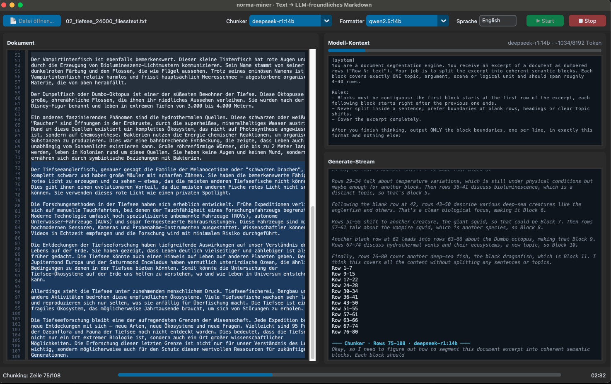

# norma-miner

Turns documents into RAG-ready Markdown without a single byte leaving the
machine. Both models run locally through Ollama, so contracts, medical
records, internal reports — anything you cannot paste into a hosted API —
can still be prepared for retrieval.

The unusual part is who decides where the text is cut. A reasoning model
reads the document in windows of numbered lines and answers with nothing
but line ranges, so blocks end where topics end rather than where a token
counter runs out. A second model then rewrites each block into dense
Markdown that a retriever can return on its own.



Twenty-five lines of flowing prose go in (excerpt), and one self-contained
block comes out — 37 % of the original length, every creature, number and
relation still in place:

```text
Die Tiefsee beherbergt eine unglaubliche Vielfalt von Kreaturen … Der
Anglerfisch ist vielleicht das bekannteste Beispiel. Das Weibchen hat einen
leuchtenden Köder an einer Verlängerung auf der Stirn … Das Männchen ist winzig
und beißt sich fest, woraufhin ihre Blutgefäße verwachsen.
```
```markdown
### Exemplarische Tiere der Tiefsee

**Anglerfisch:**
- Weibchen hat leuchtenden Köder auf Stirn für Beuteanlockung
- Männchen winzig, beißt sich an Weibchen fest und verwächst mit ihm als
  parasitisches Organ

**Riesenkalmar:**
- Bis zu 13 Meter lang, große Raubtier
- Augen größer als Tischtennisbälle – größte im Tierreich
```

## Quickstart

```bash
# 1. local backend and the two models (~18 GB of downloads)
brew install ollama            # or https://ollama.com/download
ollama serve
ollama pull deepseek-r1:14b    # chunker, 9.0 GB
ollama pull qwen2.5:14b        # formatter, 9.0 GB

# 2. this repo
pip install -r requirements.txt
python main.py                 # opens the monitor
```

In the window: **Open file…** → pick a `.txt` or `.md`, adjust models and
target language in the header if you like, then **Start**. The result
lands in `output/<name>.md`.

Expect minutes, not seconds — a 32-line document took 10 minutes on a
24 GB Mac, most of it stage 1 reasoning. Stop is safe at any point, since
the output file is rewritten after every finished block.

## Commands

```bash
python main.py                                   # GUI monitor
python main.py --cli document.txt                # headless, stream to stdout
python main.py --cli document.txt --window 60    # smaller chunker window
python main.py --cli document.txt --config other.json
```

## The two stages

They run one after another, not in parallel, so only one model is resident
at a time — two 14b models together would not fit in 24 GB.

| Stage | Model | Is given | Returns |
|---|---|---|---|
| 1 · Chunker | reasoning | A window of numbered lines (`Row 1` … `Row n`) | Only line ranges: `Row 40-64` |
| 2 · Formatter | text | One block, the chapter outline so far, and the previous block | Dense Markdown for that block |

Stage 1 never reproduces text, so it cannot hallucinate content into the
document — blocks are read from the source file by index. Details and
reasoning in [docs/chunking.md](docs/chunking.md) and
[docs/formatting.md](docs/formatting.md).

## Input and output

One file per run — `.txt` or `.md` — produces one Markdown file in
`output/`:

```markdown
# 02_tiefsee_24000_fliesstext

> Source: `02_tiefsee_24000_fliesstext` · prepared with norma-miner on 2026-09-23

---

### Exemplarische Tiere der Tiefsee
…

---

### Hydrothermale Quellen und Tiefseeanglerfisch
…
```

Blocks are separated by `---` on a line of its own, and that separator —
not the headings — is the boundary a downstream chunker should split on:
headings are written by the model and do not map one-to-one onto blocks.
This makes the output directly consumable by a structure-aware embedder
such as `text-embedder`, whose `marker` mode splits on exactly that line.

**PDFs go through [img-text-extractor](https://github.com/LinoBugia/img-text-extractor)
first.** Reading a PDF properly means OCR for scanned pages and a vision
model for figures — that tool does both and writes the figure contents
back into the text. Feeding a PDF straight into a plain text-layer reader
would silently drop every chart and table image, so norma-miner does not
offer that shortcut.

## Documentation

| Document | Contents |
|---|---|
| [docs/chunking.md](docs/chunking.md) | The row protocol, window-local numbering, the uncovered tail, overlap, repair and fallback |
| [docs/formatting.md](docs/formatting.md) | Compression without loss, the context each block sees, language handling |
| [docs/configuration.md](docs/configuration.md) | Every `config.json` field, overrides, measured prompt sizes |
| [docs/models.md](docs/models.md) | Choosing the two models, RAM, why the stages are sequential |
| [docs/gui.md](docs/gui.md) | The monitor panels, highlight colours, the event system behind them |

## Project structure

| Path | Purpose |
|---|---|
| `main.py` | Entry point: GUI, or `--cli` with `--config` and `--window` |
| `app.py` | GUI (CustomTkinter): document highlight, model context, generate stream |
| `pipeline.py` | Runs both stages, emits progress events, writes the output file |
| `chunker.py` | Stage 1: prompts, range parsing, repair, overlap, fallback |
| `formatter.py` | Stage 2: compression prompt, outline tracking |
| `ollama_client.py` | Streaming client, thinking channel and `<think>` tag fallback |
| `extract.py` | TXT/MD → normalized lines |
| `config.json` | Models, language, window and block sizes |
| `output/` | Generated Markdown |

## License

MIT — see [LICENSE](LICENSE).
