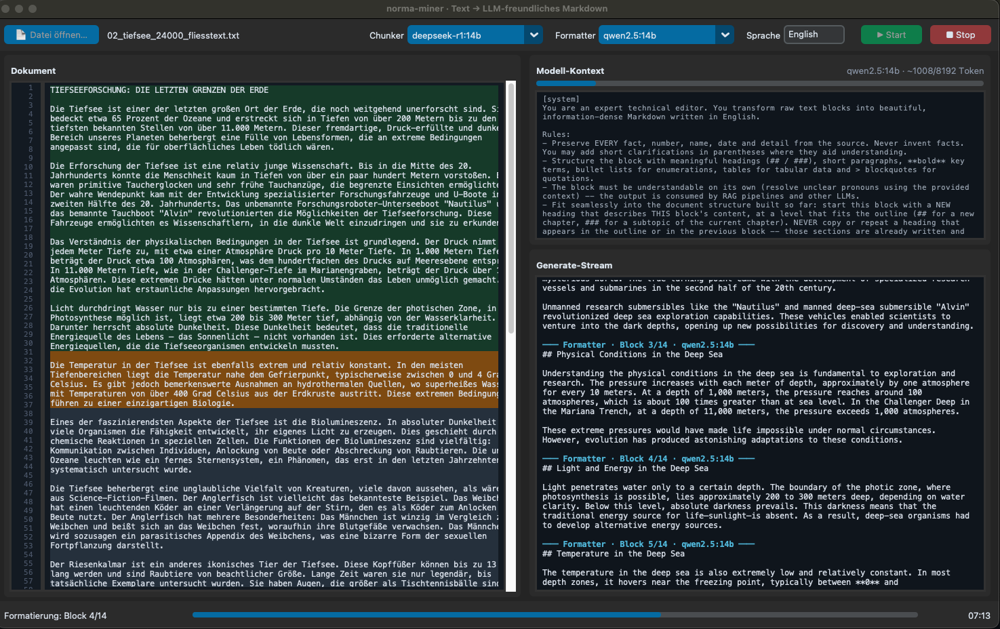

# GUI

What the monitor window shows while a document is being processed, and how
it is wired to the pipeline.

- [Header](#header)
- [Document panel](#document-panel)
- [Model context](#model-context)
- [Generate stream](#generate-stream)
- [Status bar](#status-bar)
- [How the GUI talks to the pipeline](#how-the-gui-talks-to-the-pipeline)



The window exists because both stages are slow and opaque. A run over a
long document takes tens of minutes, and without a view into it the only
feedback would be a file appearing at the end. The monitor answers the two
questions you actually have while waiting: *where in the document is it*,
and *is the model producing something sensible*.

## Header

From left to right: the file button and current file name, then the
chunker model, the formatter model, the window size, the target language,
and the Start/Stop buttons.

The two model dropdowns are filled from Ollama at startup, so they list
what you have pulled. All four fields apply to the next run only and never
write back to `config.json` — see
[configuration.md](configuration.md#where-settings-come-from).

## Document panel

The document is shown with a line-number gutter, because those numbers are
what the chunker actually reasons about. Four highlight colours show what
is happening to each region:

| Colour | State |
|---|---|
| Blue | The window the chunker is currently reading |
| Grey-blue | A block that has been accepted by stage 1 |
| Orange | The block the formatter is writing right now |
| Green | A block that is finished and written to the file |

The view scrolls to follow the active region, so a long document plays
back on its own. Blocks that come out all the same size mean the model's
answer was unusable and the [fallback](chunking.md#repair-and-fallback)
took over — that case now announces itself in orange in the stream and the
status bar, rather than leaving you to notice the pattern yourself.

## Model context

The full prompt that is going to the model right now, with a fill bar and
a token estimate above it (`~3487/8192 tokens`).

This panel is a debugging tool more than a status display. When output
looks wrong, the question is almost always whether the model was actually
told what you think it was told — which language, which outline, how much
of the previous block. The bar uses the same rough estimator as
[configuration.md](configuration.md#sizing-the-window), so if it creeps
towards full, `window_lines` is too large for the configured `num_ctx`.

## Generate stream

The model's answer as it arrives, with thinking in grey italics and
content in regular type. A cyan separator line announces each call:

```
━━ Chunker · rows 101-200 · deepseek-r1:14b ━━
```

For stage 1 this is where the row protocol becomes visible — minutes of
reasoning in grey, then a short list of ranges. For stage 2 it is the
Markdown itself, block by block.

The buffer is trimmed once it exceeds 5 000 lines. A full run produces far
more text than that, and an unbounded text widget makes the window
sluggish long before it runs out of memory.

## Status bar

Current stage or the active progress label, a bar spanning both stages,
and elapsed time. The bar's first half is stage 1 and the second half is
stage 2, which is why it moves in two distinct phases rather than evenly.

On completion it shows the output path, the number of blocks and the
runtime; on failure, the exception. Stop is cooperative — it sets a flag
the streaming client checks between packets, so the current call ends
rather than being killed, and everything written so far survives.

## How the GUI talks to the pipeline

`pipeline.py` contains no GUI code. It reports progress by calling an
`emit` function with event dicts:

```
doc_loaded  stage  window  context  stream_reset  stream  chunk
fallback  format_current  chunk_done  progress  done  error  aborted
```

The pipeline runs in a worker thread and `emit` is the queue's `put`. The
GUI drains that queue every 50 ms on the Tk thread, which keeps all widget
access single-threaded without any locking. The CLI passes a function that
prints instead.

That is the whole coupling, and it is why both frontends behave
identically: they consume the same events. A third frontend would be one
more `emit` function.
